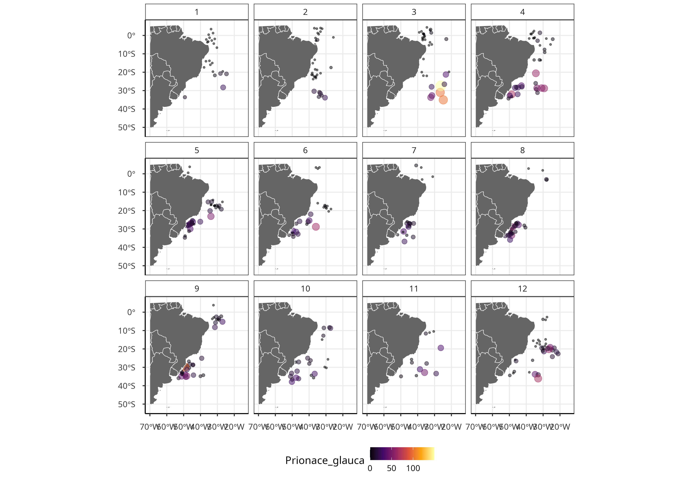
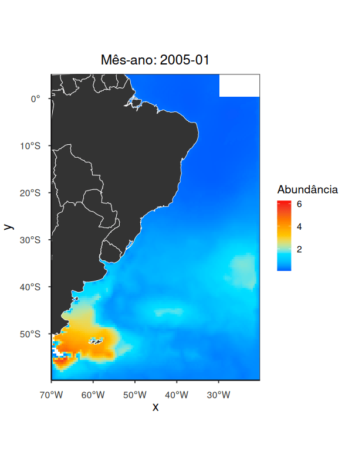

# Spatio-temporal Modelling

Este repositório tem como objetivo apresentar o resultado da prática desenvolvida na disciplia de Modelagem Espaço-Temporal no R, ministrada pela Profª. Dra. Marie.

A ideia é aplicar Estatística Bayesiana para modelar a biomassa do Tubarão-Azul (_Prionace glauca_) no espaço e no tempo. A partir dos resultados do melhor modelo, será realizado uma predição de biomassa para locais que não foram amostrados (i.e. interpolação).

Abaixo, podemos observar como a biomassa de _Prionace glauca_ está distribuída ao longo do espaço e do tempo:

  

E em seguida, as predições realizada para o espaço e tempo de _Prionace glauca_ na costa brasileira:

  

E então, temos um gif animado.
